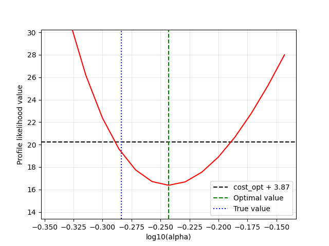

# Parameter Identifiability of ODE Models via Profile Likelihood

Data based identifiability analysis applied to ODE models, using the profile likelihood. The code is class that applies the method to the lotka volterra model. The user has the freedom to test various scenarios with synthetic data.

## Contents

| File | Description |
|------|-------------|
| `Parameter_Estimation_lotka_volterra.py` | Parameter estimation for the Lotka-Volterra predator-prey model |
| `run_identifiability.ipynb` | Notebook that computes the profile likelihood and extracts the likelihood-based confidence intervals |
| `FiguresProfileLikelihood_*/` | Saved profile-likelihood data (`.txt`) and figures (`.png`), including those shown under Results |

## Installation

Requires Python 3.9+.

1. (Recommended) Create and activate a virtual environment:

   ```powershell
   python -m venv .venv
   .venv\Scripts\Activate.ps1
   ```

   On Linux/macOS: `source .venv/bin/activate`

2. Install the packages:

   ```bash
   pip install numpy scipy matplotlib pathos jupyter ipykernel
   ```

| Package | Used for |
|---------|----------|
| `numpy`, `scipy` | ODE integration (`odeint`), optimisation (`minimize`), Latin hypercube sampling (`qmc`) |
| `matplotlib` | Profile-likelihood plots |
| `pathos` | Multiprocessing of the multi-start calibration |
| `jupyter`, `ipykernel` | Running the notebooks |

## Usage

Open `run_identifiability.ipynb` and run the cells, or use the modules directly:

```python
from identifiability_lotka_volterra import Identifiability_Analysis_lotka_volterra

ID_LV = Identifiability_Analysis_lotka_volterra(14, sigma=0.01, n_pm_search_lattice_points=30)
phi_opt, cost_opt = ID_LV.calibrate_trust_region()
ID_LV.profile_likelihood_simple_(0, n_points=15, show_plot=True)  # profile for parameter index 0
ID_LV.extract_confidence_intervals()
```

## Method (summary)

- Parameters are estimated in log10 space by least squares (multi-start trust-region optimisation).
- For each parameter, the others are re-optimised and the resulting costs forms the profile.
- The confidence interval is the set of values where the profile stays below the confidence threshold `cost_opt + threshold` (95 confidence threshold = 3.87 by default).

## Results

Example profile likelihood for `alpha` (known initial conditions, sigma = 0.01). The red curve is the profile likelihood, the dashed black line is the 95 percent confidence threshold. the green line is the maximum likelihood estimate of `alpha` and the blue line the true value. The confidence interval corresponds to the values of `alpha` for which the profile likelihood stays below the confidence threshold.




## License

_To be added._
_To be added._
